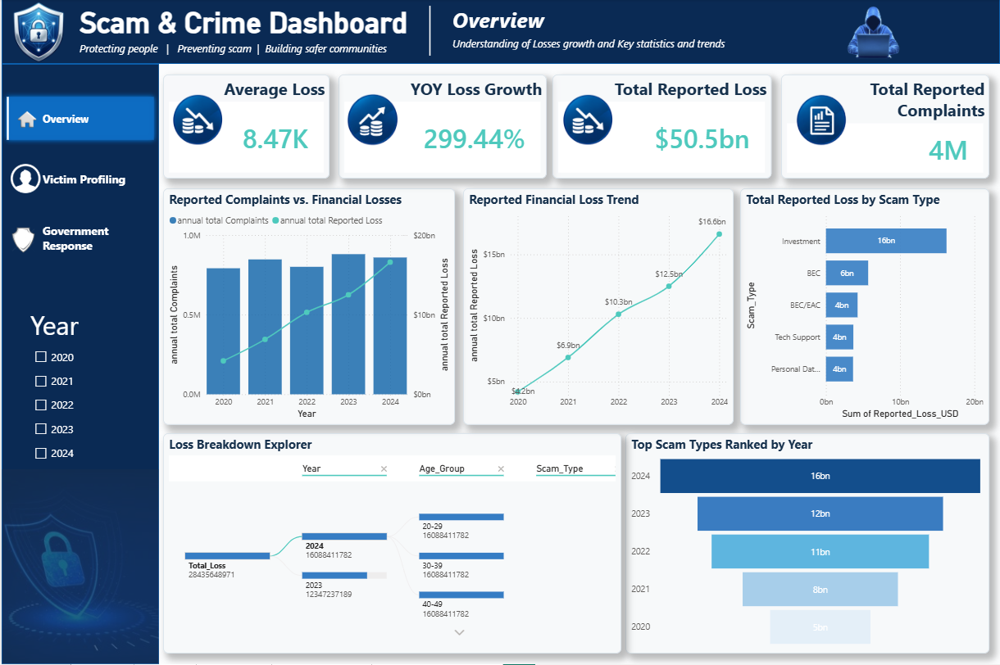

# Scam Execution & Victim Profiling (U.S., 2020–2024)

An end-to-end data analytics project built during the **Psyliq Investigative Data Analysis Internship (Project 1)**. It analyzes five years of U.S. scam and fraud data to answer three questions:

1. **Who** is being victimized, and where?
2. **How** do scammers execute successful fraud?
3. **How** is the government responding?

## Dashboard Preview

**Overview**


**Victim Profiling**


**Government Response**


## Data Sources

- FBI Internet Crime Complaint Center (IC3) Annual Reports, 2020–2024
- FTC Consumer Sentinel Network Data Books, 2020–2024
- U.S. Department of Justice press releases and case materials (10 enforcement actions)

## Tools

| Stage | Tool |
|---|---|
| Data collection and structuring | Excel |
| Validation and analysis | Python (Pandas, Matplotlib/Seaborn), SQL (SQLite) |
| Visualization | Power BI |
| Analysis deliverable | Jupyter Notebook |

## Key Findings

- **Losses nearly quadrupled** from $4.2B (2020) to $16.6B (2024), while complaint volume stayed roughly flat (about 792K to 860K).
- **Victims aged 60+ are the fastest-growing group:** complaints rose 39.7% from 2020 to 2024, including a 45.6% jump in 2024 alone. Ages 20–29 stayed flat (+0.9%).
- **Volume and cost are inverted.** Phishing/Spoofing had the most complaints in 2024 (193,407) but only $70M in losses. Investment fraud had under 48,000 complaints but $6.57B in losses.
- **Cryptocurrency was the largest loss vector in 2024:** 149,686 complaints and $9.3B in losses. Payment apps overtook debit cards as a top payment method demanded.
- **Enforcement gap:** none of the 10 DOJ actions reviewed targeted phishing directly, even though it drives the most complaints.
- **Highest recovery per action:** the DOJ Consumer Protection Branch with the U.S. Attorney's Office (District of Colorado), averaging $74.75M per action.

## Repository Structure

```
├── README.md
├── report/      Final_Report_P1.pdf
├── notebook/    Psyliq_P1_Scam_Profiling.ipynb
├── data/        Data_Matrix_P1.xlsx
└── images/      dashboard screenshots
```

## Limitations

- The government-response analysis uses 10 representative DOJ actions, not the full caseload.
- One action had no stated recovery figure and was excluded from recovery averages rather than estimated.
- IC3 complaint counts are not unique victims. The IC3 phishing category name changed across report years, so the 2024 single-year view is used for scam-type ranking.

## Author

**Santhiya V** | Data Analytics | Power BI · SQL · Python · Excel
[LinkedIn](https://www.linkedin.com/in/santhiya-v-5243bb417)
